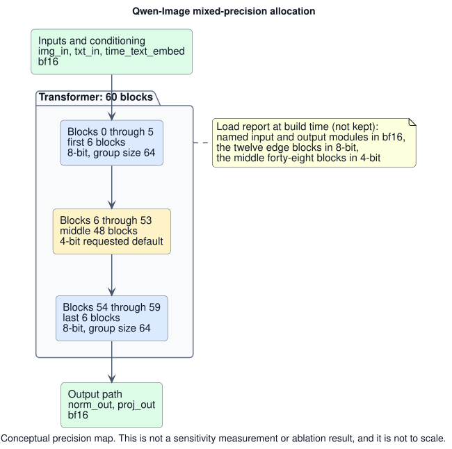
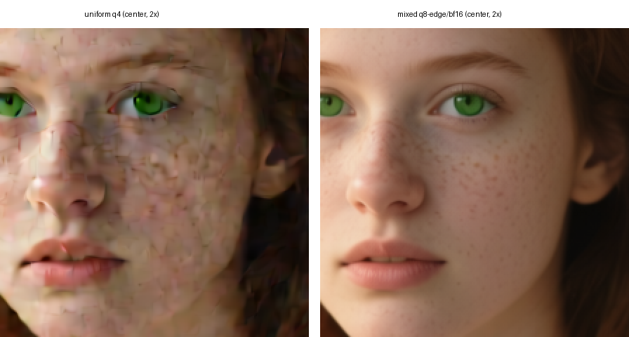
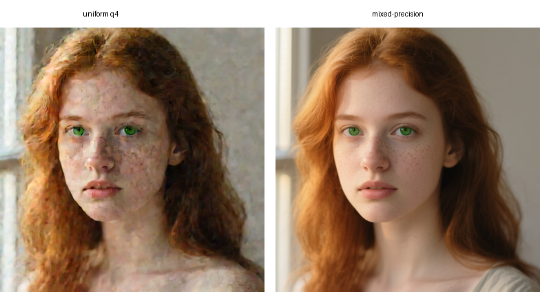

# Qwen-Image Mixed Precision on a 32 GB Mac

*A case study from `mlx-teacache`'s Qwen-Image showcase: diagnosing a visual artifact
in a uniform 4-bit build and removing it at the cost of additional memory*

> 📄 [Read on the website](https://ineshin.space/papers/qwen-image-mixed-precision-on-a-32-gb-mac/) — same paper, formatted for reading.

## Update, 2026-11-13: what changed in this paper

The [previous version](https://github.com/IonDen/mlx-teacache/blob/b8fc4ff/docs/papers/qwen-image-mixed-precision-on-a-32-gb-mac.md)
gave peaks for 512×512 and 768×768 and put the mixed build's memory cost over uniform 4-bit at
about 1.9 GiB. No published record holds the 512×512 peaks or the uniform 4-bit 768×768 peak, and
the repository's committed records disagree with that 768×768 peak, so those figures are gone.
Section 5 now gives the two committed 768×768 peaks, each with its run; they were not measured as
a pair and suggest a cost of a few GiB. The recipe was tested on mflux 0.17.5 and does not
rebuild the tested model as written on mflux 0.24 or later, which mlx-teacache now requires
(section 4); mflux's own 4-bit build there keeps every block's `img_mod_linear` at 8 bits, which
this recipe does only in its edge blocks. The TeaCache transfer result is now described without
its similarity score, because that sweep was not published and has been superseded. Also gone:
quotations the cited abstracts do not contain, the comparison page that no longer covers the
mixed build, the module counts of a load report that was not kept, and a guidance check that no
recorded run supports.

---

[Qwen-Image](https://huggingface.co/Qwen/Qwen-Image) has about 20 billion parameters. Its bf16
weights alone need roughly 40 GB, so a 32 GB Mac calls for lower precision. Our first baseline,
mflux with `quantize=4`, produced a portrait with a cracked skin texture. Changes to resolution,
schedule, prompt suffix, and VAE settings did not remove it. A mixed-precision recipe
did. It protected a small set of layers at the cost of more memory. This paper documents
that one-prompt, one-seed result and does not claim a general Qwen-Image sensitivity map.

### Evidence scope

- Model: Qwen-Image, a multimodal diffusion transformer (MMDiT) for text-to-image generation
  ([technical report, arXiv:2508.02324](https://arxiv.org/abs/2508.02324)), running through
  [mflux](https://github.com/filipstrand/mflux) on Apple Silicon.
- Machine: Apple M1 Max with 32 GB of unified memory.
- Software: the recipe targets the mflux 0.17.5 API, and the committed 768×768 run used
  mflux 0.17.5; the mflux version of the 512×512 pair was not recorded. Section 4 explains why
  the recipe does not carry over unchanged to the mflux releases mlx-teacache supports today.
- Project context: the investigation took place in June 2026 during the `mlx-teacache`
  Qwen-Image integration. The public
  [variant page](https://github.com/IonDen/mlx-teacache/blob/v0.17.0/docs/variants/qwen-image.md)
  and the [v0.9.0 changelog entry](https://github.com/IonDen/mlx-teacache/blob/v0.17.0/CHANGELOG.md)
  record the outcome.
- Evidence: the 512×512 pair is shown in Figures 2 and 3; no memory record of that pair was kept.
  Two committed benchmark reports give the 768×768 peaks discussed in section 5. We did not rerun
  any experiment for this paper.
- Scope: the recipe changes model construction, not TeaCache. `mlx-teacache` neither builds nor
  quantizes models. Its comparison images merely exposed the problem.

## 1. The symptom

We constructed mflux with `quantize=4`, which applies uniform 4-bit affine quantization to each
eligible module. The test portrait showed fine cracks across the skin, worst near the center.
The pattern appeared with the official 50-step CFG recipe and with shorter schedules. At 2× crop,
it looks reticulated, almost like dried mud rather than ordinary image grain.

The problem first appeared in a TeaCache comparison, so TeaCache was the first suspect. Vanilla
and wrapped generation on the same build showed the same reticulation. We therefore ran the
remaining experiments with vanilla mflux and treated model construction as the source.

## 2. The hypotheses that did not survive

Several simpler explanations fit the symptom. We tested them directly or checked them against
the official implementation before changing quantization:

| Hypothesis | Verdict | Evidence |
|---|---|---|
| Output resolution too low | rejected | artifact present at 512², 768², and 1024² |
| Too few denoising steps | rejected | present at 20 and at 50 steps |
| Missing official prompt suffix | marginal | the official `positive_magic` suffix barely moved it |
| Wrong flow-match scheduler shift | rejected | mflux's shift parameters and resolution-dependent `mu` match the official Qwen values |
| VAE decode or latent normalization | rejected | mflux's 16-channel latent mean/std constants match the official VAE; decode denormalizes correctly |
| VAE tiling seams | rejected | 1024² tiled decode with overlap showed no grid-aligned seams |

The resolution, step-count, prompt-suffix and tiling rows are the author's visual checks of test
images that were not published. The scheduler and VAE checks used official Qwen-Image source,
not only generated images. Both had plausible community theories behind them, but neither matched the implementation. The uniform-q4
baseline still left one obvious variable untouched: layer-level weight precision.

## 3. Why quantization was the credible suspect

Prior work shows that low-bit quantization does not affect every part of a diffusion transformer
equally. Mixed-precision methods respond by spending more bits on the parts they find most
sensitive. That gave us a plausible direction for the next build.

### Position and conditioning paths can be sensitive

[Qua²SeDiMo (AAAI 2025, arXiv:2412.14628)](https://arxiv.org/abs/2412.14628) builds
per-layer sensitivity maps for diffusion denoisers. In its analysis, the final output layer of
DiT models comes out more sensitive to quantization than the corresponding layer in U-Net
models, and the timestep-embedding block shows a high-sensitivity signature.
[SVDQuant (ICLR 2025, arXiv:2411.05007)](https://arxiv.org/abs/2411.05007), a 4-bit method
for FLUX-class models, keeps the inputs of the adaptive-normalization linear layers at 16
bits rather than quantizing them with everything else.

Block position appears in two other sources.
[SQ-DM (arXiv:2501.15448)](https://arxiv.org/abs/2501.15448) states the block-position case
directly: in its analysis the first and last few blocks are generally the more sensitive ones,
and it keeps those blocks at higher precision than the 4-bit used elsewhere.
[TreeQ (arXiv:2512.06353)](https://arxiv.org/abs/2512.06353), a December 2025 preprint on
mixed-precision search for diffusion transformers, treats keeping the embedding and final layers
in full precision as the shared baseline of the methods it compares.

For MMDiT block roles,
[Unraveling MMDiT Blocks (arXiv:2601.02211)](https://arxiv.org/abs/2601.02211) is a
training-free analysis rather than a quantization study. It finds that early blocks carry
semantic structure while later blocks render fine detail. That result is consistent with
protecting the edge blocks.

### The observed texture resembles reported low-bit failures

[PTQ4DiT (NeurIPS 2024, arXiv:2405.16005)](https://arxiv.org/abs/2405.16005) describes an
outlier-driven mechanism. It locates the
error in "salient channels with extreme magnitudes" rather than spreading it
uniformly. TreeQ reports losses in fine-grained, high-frequency detail and structured local
features. Its spatial-feature metrics deteriorate
even while global fidelity metrics stay reasonable. A reticulated skin texture on an
otherwise coherent portrait resembles that failure class, although this study has no
higher-precision reference that would establish which output is more faithful.

Community builders reached a similar position-protection design for Qwen-Image.
[city96's Qwen-Image GGUF builds](https://huggingface.co/city96/Qwen-Image-gguf) keep the
first and last layer at high precision in their lower-bit variants. The model card describes
this as new dynamic quantization logic.
[QuantStack's Qwen-Image GGUF conversions](https://huggingface.co/QuantStack/Qwen-Image-GGUF)
ship the same K-quant family for Qwen-Image.

The evidence does not transfer cleanly to this case. Some methods differentiate precision by
operation type rather than block position.
[HQ-DiT (arXiv:2405.19751)](https://arxiv.org/abs/2405.19751) applies FP4 to every
fully-connected layer in every block, so position protection is an established convention,
not a settled law.

Much of the sensitivity evidence also concerns joint weight-and-activation
quantization (W4A4/W4A8), not the weight-only 4-bit setup used here. Both regimes protect
similar layers, but applying that convention to weight-only quantization remains an assumption.
None of this proves
that uniform q4 causes *this* artifact on *this* model. We found no peer-reviewed,
Qwen-Image-specific quantization-sensitivity study published by July 2026. The literature made
quantization worth testing, so the next experiment changed the model build.

## 4. The recipe

[`mlx.nn.quantize`](https://ml-explore.github.io/mlx/build/html/python/_autosummary/mlx.nn.quantize.html)
accepts a `class_predicate` callable. The callable receives each module's path and instance. It
can return:

- `False` to keep the module at model precision, here bf16;
- `True` to use the requested default precision, here 4-bit; or
- a parameter dict such as `{"group_size": 64, "bits": 8}` to select another precision.

mflux routes model construction through
[`QwenWeightDefinition.quantization_predicate`](https://github.com/filipstrand/mflux/blob/v.0.17.5/src/mflux/models/qwen/weights/qwen_weight_definition.py),
which quantizes every quantizable module uniformly when the caller requests quantization
(`return hasattr(module, "to_quantized")`). mflux itself defaults `quantize` to `None`; uniform
q4 is produced only when the caller selects `quantize=4`. Overriding the predicate before
constructing that model yields mixed precision with no changes to mflux itself.

Qwen-Image has
[60 transformer blocks](https://github.com/filipstrand/mflux/blob/v.0.17.5/src/mflux/models/qwen/model/qwen_transformer/qwen_transformer.py).
The recipe assigns precision as follows:

| Precision | Modules |
|---|---|
| bf16 (skipped by the predicate) | `img_in`, `txt_in`, `time_text_embed`, `proj_out`, `norm_out` |
| 8-bit, group size 64 | transformer blocks 0 through 5 and 54 through 59 (first six + last six) |
| 4-bit (default) | the middle 48 blocks |



*Figure 1. Conceptual map of the precision recipe. The block ranges and precision assignments
come from the construction predicate. This is not a layer-sensitivity measurement or ablation
result, and the blocks are not drawn to scale. The
editable [PlantUML source](https://github.com/IonDen/mlx-teacache/blob/main/docs/papers/diagrams/qwen-image-mixed-precision-allocation.puml)
is published with the paper.*

At load time the build's report showed the named modules kept in bf16, the twelve edge blocks
quantized to 8-bit, and the middle forty-eight to 4-bit. That report was not kept, so this paper
gives no module counts. Analogous work informed the bf16 set. `img_in` and `txt_in` are the embeddings;
`proj_out` is the final projection. `time_text_embed` and `norm_out` sit on the timestep and
output-normalization paths. The cited studies do not establish
that these specific Qwen-Image modules are sensitive under weight-only quantization. The
construction snippet is adapted from the recipe shipped in the
[public variant documentation](https://github.com/IonDen/mlx-teacache/blob/v0.17.0/docs/variants/qwen-image.md):

```python
from mflux.models.qwen.weights.qwen_weight_definition import QwenWeightDefinition
from mflux.models.qwen.variants.txt2img.qwen_image import QwenImage
from mflux.models.common.config.model_config import ModelConfig

_PROTECT = set(range(6)) | set(range(54, 60))           # first 6 + last 6 of 60 blocks -> q8
_BF16 = ("img_in", "txt_in", "time_text_embed", "proj_out", "norm_out")  # -> bf16

def _mixed(path, module):
    if not hasattr(module, "to_quantized"):
        return False
    if any(path == p or path.startswith(p + ".") for p in _BF16):
        return False                                    # keep bf16
    if path.startswith("transformer_blocks."):
        idx = int(path.split(".")[1])
        if idx in _PROTECT:
            return {"group_size": 64, "bits": 8}        # q8
    return True                                         # default q4

_original = QwenWeightDefinition.__dict__["quantization_predicate"]
QwenWeightDefinition.quantization_predicate = staticmethod(_mixed)
try:
    flux = QwenImage(quantize=4, model_config=ModelConfig.qwen_image())
finally:
    QwenWeightDefinition.quantization_predicate = _original
```

This mechanism has a practical caveat. It monkeypatches a class attribute because
mflux 0.17.5 offers no per-instance way to inject a predicate into `QwenImage` construction.
The `finally` block restores the original predicate after construction. During construction,
however, the override remains process-global. Another thread must not construct a Qwen model at
the same time. The hook is also fragile across mflux refactors, so a native mflux option would be
safer than this snippet.

The recipe was tested on mflux 0.17.5 only, and it does not rebuild the tested model as written
on mflux 0.24 or later, which mlx-teacache has required since its 0.15.0 release
([changelog at v0.17.0](https://github.com/IonDen/mlx-teacache/blob/v0.17.0/CHANGELOG.md)). Two
mflux changes, both recorded on the
[variant page at v0.17.0](https://github.com/IonDen/mlx-teacache/blob/v0.17.0/docs/variants/qwen-image.md),
explain why. From mflux 0.19 the `qwen-image` alias, which `ModelConfig.qwen_image()` resolves,
loads the newer Qwen-Image-2512 checkpoint instead of the original Qwen-Image, so the snippet as
written builds a different checkpoint. From the same release, mflux's own 4-bit Qwen build keeps
every block's `img_mod_linear` modulation layer at 8 bits. That rule lives inside
[`QwenWeightDefinition.quantization_predicate`](https://github.com/mflux-community/mflux/blob/v.0.24.0/src/mflux/models/qwen/weights/qwen_weight_definition.py),
the attribute the snippet replaces. The snippet's own map therefore still governs: it leaves
those layers at 4 bits in the 48 middle blocks, as the tested build did, and drops the protection
mflux now gives them by default. Stock q4 on a current mflux is thus a different baseline from the
one compared here. The variant page shows how to load the original checkpoint on newer mflux;
this mixed recipe was not tested that way.

## 5. Results

The 512×512 experiment kept the generation inputs fixed and changed the construction predicate.
The author's notes record 50 steps, seed 42, and `guidance=4.0` on the 32 GB M1 Max; the mflux
version of that run was not recorded. The exact portrait prompt and MLX version were not retained
either, which limits reproduction of this pair.

| Build | Author's visual assessment |
|---|---|
| uniform q4 (`quantize=4`) | cracked / reticulated |
| mixed precision (recipe above) | reticulation largely absent; preferred result |

No memory record of this 512² pair was kept, so this paper gives no peak for it. The visual
comparison is the author's judgment of the two outputs in Figures 2 and 3.



*Figure 2. Center crops at 2× from two synthetic Qwen-Image outputs generated with the same
prompt, seed, steps, and guidance. Left: uniform 4-bit. Right: mixed precision. The outputs
differ globally, so this pair supports only the visible before/after comparison, not identity
preservation or fidelity to a higher-precision reference.*



*Figure 3. The full synthetic frames behind Figure 2. Changing the quantization predicate
changed facial geometry, framing, hair, clothing, lighting, background, and texture. The pair
therefore demonstrates a substantial output change and the disappearance of the observed
reticulation, not a texture-only repair.*

The project's separate 768×768 showcase used the same mixed predicate and completed on the test
machine. Its
[committed comparison report](https://github.com/IonDen/mlx-teacache/blob/v0.17.0/_artifacts/comparison_report.json)
records, in the vanilla arm of the `qwen-image` row, a peak of 30.42 in the `peak_memory_gb`
field. That row was generated on 2026-06-18 with mflux 0.17.5 and mlx-teacache 0.9.0 and records
no MLX version. The
[variant page](https://github.com/IonDen/mlx-teacache/blob/v0.17.0/docs/variants/qwen-image.md)
rounds it to about 30.4 and labels it GB. The run used 50 steps, `guidance=4.0`, seed 42, and the portrait
prompt printed in the report. No public image pair compares uniform q4 and the mixed build at
768×768, so the visual improvement at this size has no published record.

No uniform-q4 run was published with that report's prompt and mflux version. The closest tracked
uniform-q4 figure comes from a different run. The
[v0.10.0 Qwen-Image benchmark](https://github.com/IonDen/mlx-teacache/blob/v0.17.0/_artifacts/v0.10.0_bench_qwen_image.json)
records 26.16 in `vanilla_peak_memory_gb` for stock `quantize=4` at 768×768, 50 steps,
`guidance=4.0`, and seed 42, with the prompt "a red apple on a wooden table", on mflux 0.18.0
and the same 32 GB M1 Max (three repetitions, each in its own subprocess; no MLX version
recorded). The two runs differ in mflux version, prompt, and harness. They were not measured as a
controlled pair, so their difference is not a measured cost of the recipe. Taken only as a rough
indication, they put the mixed build's cost at a few GiB over stock q4 on a 32 GB Mac.

Both fields hold `mx.get_peak_memory() / 1024**3`, as
[`bench_comparison.py` at v0.9.0](https://github.com/IonDen/mlx-teacache/blob/v0.9.0/scripts/bench_comparison.py#L245)
and [`bench_speedup.py` at v0.10.0](https://github.com/IonDen/mlx-teacache/blob/v0.10.0/scripts/bench_speedup.py#L330)
compute them, so the values are GiB although the field names say gb. Each is MLX's peak
allocation in the benchmarking process, not total process or system memory. Subtracting either
figure from 32 GB would not measure system-memory headroom.

A simple weight calculation explains the pressure. At about 20 billion parameters, 8-bit
weights need roughly 20 GB and bf16 weights roughly 40 GB. The text encoder, VAE, activations,
and quantization metadata need additional memory. We did not measure either full-precision
alternative.

The mixed recipe instead protects twelve of sixty blocks at 8-bit and a handful of modules at
bf16, and it completed on the test machine. No precision sweep established that the recipe is
unique or minimal.

The TeaCache gate coefficients shipped for Qwen-Image were calibrated on the stock uniform-q4
build. At the time of this study, they transferred to the mixed-precision build without
recalibration. The
[variant page](https://github.com/IonDen/mlx-teacache/blob/v0.17.0/docs/variants/qwen-image.md)
summarizes a June 2026 threshold sweep on the mixed build, under the gate of the 0.9.x releases,
as a sensible skip ramp at high structural similarity, and marks it as superseded: the gate has changed since, the
default threshold was re-swept on stock q4, and the mixed build was not swept again. That is an
empirical transfer result for one gate version; the study did not measure how far the mixed
recipe moved the latent trajectory.

The wrapper also reproduced each base build's visible behavior. This separated the
model-construction effect from the cache behavior.

## 6. Scope and limitations

The study is narrow, so the claims need the following limits:

- The public before/after comparison is a single controlled 512² pair from one prompt, one seed,
  and one M1 Max. The reticulation's visibility was consistent across the resolutions and step
  counts tested, in the author's unpublished test images, but no prompt sweep, seed sweep, or
  second machine backs the result. The exact 512² prompt text, MLX version and mflux version were
  not retained; the
  separate 768² run has a public recipe and measurement artifact, but no public uniform/mixed
  visual pair.
- "Largely cleared" is a visual judgment of the rendered portraits, not a perceptual metric.
  No full-precision reference, FID, LPIPS, rater study, or seed sweep establishes that the
  preferred image is more faithful to the model's intended distribution.
- The first-six-plus-last-six recipe, with bf16 embeddings and output projection, was the first
  configuration that worked. Prior work informed that choice. The study did not remove
  protections one at a time, so the set may not be minimal. It also did not measure a per-layer
  Qwen-Image sensitivity profile.
- In one pair, from one prompt and one seed, the reticulation went away when the construction
  predicate changed. One pair cannot show that the recipe removes it in general, and it does not
  show which protected layer matters most. Fewer 8-bit blocks might be enough.
- No memory record of the 512² pair was kept. The two 768² figures come from committed reports
  of different runs, record no MLX version, and are MLX's peak allocation in GiB, not total
  process or system memory. None of the numbers was re-measured for this paper.
- The recipe was tested on mflux 0.17.5 only. On the mflux releases mlx-teacache now supports, the
  alias loads a different checkpoint and stock q4 is a different baseline (section 4), and the
  recipe has not been tested there.

## 7. Lessons

### Treat uniform quantization as a baseline

With `quantize=4`, mflux 0.17.5 treated every quantizable module of the transformer
identically; from mflux 0.19 its 4-bit build already keeps the `img_mod_linear` modulation layers
at 8 bits. Analogous literature and community builds motivated a concentrated protection set. In
this case it cost extra memory, a few GiB by two reports that were not measured as a pair, and
produced the author's preferred result for the tested portrait.

### Check cheap hypotheses in source

Two of the six hypotheses, scheduler shift and VAE constants, had plausible community theories
attached. Both were settled by comparing the port's constants against the official release,
which is faster
and more conclusive than generating test images against a moving visual target.

### Separate wrapper behavior from model behavior

The step-skipping cache was the first suspect because it was the newest component. One comparison
exonerated it: vanilla and wrapped output shared the visible reticulation. The harness makes this
vanilla-versus-wrapped check routine and inexpensive.

### Put the recipe where users will find it

The mixed-precision recipe lives outside the library's scope, but its documentation is where a
32 GB Qwen-Image user will find the problem. The variant page carries the construction snippet
and says plainly that stock q4 is grainy on this model.

## Claims and status

In short, this case supports a narrow result. For one 512×512 image, the mixed build removed the
cracks seen with uniform q4. The same build also ran at 768×768 on the test Mac. The study does
not tell us whether the image is closer to full precision. It also does not identify the smallest
working protection set or show that the same layers matter for other prompts.

| Claim | Status | Source |
|---|---|---|
| With `quantize=4`, the tested Qwen-Image portrait showed visible skin reticulation on this hardware and recipe | the author's observation, shown in Figures 2 and 3; also observed across the tested resolutions and step counts in unpublished test images | [variant page at v0.17.0](https://github.com/IonDen/mlx-teacache/blob/v0.17.0/docs/variants/qwen-image.md); [changelog at v0.17.0](https://github.com/IonDen/mlx-teacache/blob/v0.17.0/CHANGELOG.md) |
| The mixed recipe removed the visible reticulation and produced the author's preferred 512² output | one controlled prompt/seed pair; subjective assessment; no high-precision reference (Figures 2 and 3) | this paper's figures |
| At 768², the mixed build peaked at 30.42 (portrait prompt, mflux 0.17.5, 2026-06-18) and a separate stock-q4 run at 26.16 (red-apple prompt, mflux 0.18.0), as the reports' `peak_memory_gb` and `vanilla_peak_memory_gb` fields record them (GiB, computed as `mx.get_peak_memory() / 1024**3`) | two committed records of different runs, not a controlled pair; peak MLX allocation, not total system use; no MLX version recorded; no memory record of the 512² pair | [comparison report at v0.17.0](https://github.com/IonDen/mlx-teacache/blob/v0.17.0/_artifacts/comparison_report.json); [v0.10.0 Qwen-Image benchmark at v0.17.0](https://github.com/IonDen/mlx-teacache/blob/v0.17.0/_artifacts/v0.10.0_bench_qwen_image.json) |
| Protecting edge blocks and selected input, conditioning, and output modules is a plausible mixed-precision heuristic | motivated by analogous literature and community practice; not a measured Qwen-Image sensitivity map | [SQ-DM](https://arxiv.org/abs/2501.15448); [Qua²SeDiMo](https://arxiv.org/abs/2412.14628); [SVDQuant](https://arxiv.org/abs/2411.05007); [city96 GGUF builds](https://huggingface.co/city96/Qwen-Image-gguf) |
| TeaCache coefficients calibrated on stock q4 transferred to the mixed build under the 0.9.x gate | a June 2026 threshold sweep on the mixed build, summarized on the variant page and since superseded; the mixed build was not re-swept under the current gate | [variant page at v0.17.0](https://github.com/IonDen/mlx-teacache/blob/v0.17.0/docs/variants/qwen-image.md) |
| mflux 0.17.5 exposes the predicate as a class attribute rather than a per-instance constructor option | source inspection of the version used | [`qwen_weight_definition.py` at v.0.17.5](https://github.com/filipstrand/mflux/blob/v.0.17.5/src/mflux/models/qwen/weights/qwen_weight_definition.py) |
| The recipe as written targets mflux 0.17.5 and does not rebuild the tested model as written on mflux 0.24 or later | mlx-teacache requires mflux 0.24; from mflux 0.19 the `qwen-image` alias loads Qwen-Image-2512, and mflux's own 4-bit predicate, which the snippet replaces, keeps `img_mod_linear` at 8 bits, so stock q4 there is a different baseline | [changelog at v0.17.0](https://github.com/IonDen/mlx-teacache/blob/v0.17.0/CHANGELOG.md); [variant page at v0.17.0](https://github.com/IonDen/mlx-teacache/blob/v0.17.0/docs/variants/qwen-image.md); [`qwen_weight_definition.py` at v.0.24.0](https://github.com/mflux-community/mflux/blob/v.0.24.0/src/mflux/models/qwen/weights/qwen_weight_definition.py) |

## References and source notes

- [Qwen-Image model card](https://huggingface.co/Qwen/Qwen-Image) (Apache-2.0; ~20B; official
  50-step / `true_cfg_scale=4.0` recipe) and the
  [Qwen-Image Technical Report, arXiv:2508.02324](https://arxiv.org/abs/2508.02324).
- [mflux](https://github.com/filipstrand/mflux): MLX port used for all generations;
  pinned-source links in the text reference tag
  [`v.0.17.5`](https://github.com/filipstrand/mflux/tree/v.0.17.5).
- [`mlx.nn.quantize` documentation](https://ml-explore.github.io/mlx/build/html/python/_autosummary/mlx.nn.quantize.html)
  (the `class_predicate` protocol the recipe relies on).
- Diffusion-transformer quantization sensitivity and mixed precision:
  [Qua²SeDiMo, AAAI 2025, arXiv:2412.14628](https://arxiv.org/abs/2412.14628);
  [SVDQuant, ICLR 2025, arXiv:2411.05007](https://arxiv.org/abs/2411.05007);
  [PTQ4DiT, NeurIPS 2024, arXiv:2405.16005](https://arxiv.org/abs/2405.16005);
  [SQ-DM, arXiv:2501.15448](https://arxiv.org/abs/2501.15448);
  [TreeQ, arXiv:2512.06353](https://arxiv.org/abs/2512.06353) (preprint);
  [ViDiT-Q, ICLR 2025, arXiv:2406.02540](https://arxiv.org/abs/2406.02540);
  [MixDiT, IEEE LCA 2025, arXiv:2504.08398](https://arxiv.org/abs/2504.08398);
  [HQ-DiT, arXiv:2405.19751](https://arxiv.org/abs/2405.19751) (the uniform op-type
  counterpoint);
  [Unraveling MMDiT Blocks, arXiv:2601.02211](https://arxiv.org/abs/2601.02211) (block-role
  analysis, cited for early-block semantics rather than quantization evidence).
- Community mixed-precision practice on this exact model:
  [city96/Qwen-Image-gguf](https://huggingface.co/city96/Qwen-Image-gguf) and
  [QuantStack/Qwen-Image-GGUF](https://huggingface.co/QuantStack/Qwen-Image-GGUF).
- Project records used as documentary cross-checks, all at tag v0.17.0:
  [CHANGELOG](https://github.com/IonDen/mlx-teacache/blob/v0.17.0/CHANGELOG.md),
  the [qwen-image variant page](https://github.com/IonDen/mlx-teacache/blob/v0.17.0/docs/variants/qwen-image.md),
  the [comparison report](https://github.com/IonDen/mlx-teacache/blob/v0.17.0/_artifacts/comparison_report.json),
  and the [v0.10.0 Qwen-Image benchmark](https://github.com/IonDen/mlx-teacache/blob/v0.17.0/_artifacts/v0.10.0_bench_qwen_image.json).

---

*Prepared 2026-07-20. Last updated 2026-11-13. Denis Ineshin.*
